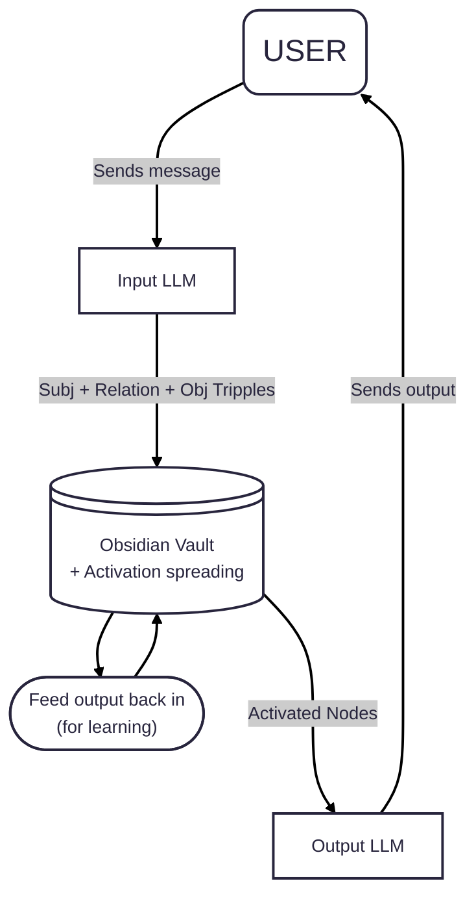

L.O.U.I.S
=========

Lars Origianl Usefull Intelligent System 

## What is LOUIS
LOUIS is an experiment to create a "better" generation of artificial intelligence, building upon the current generation of **LLMs** combined with the power of **semantic networks** with **spread activation**.

The goal of this project is to create a 'template' that can be used to create artificial intelligence models with different personas and expertise.

## How does it work
The following diagram explains the basic working of LOUIS. A detailed explanation follows afterwards.

### Input LLM
LOUIS uses a standard LLM Model to convert natural language input into Subj + Relation + Obj Tripples, that it can understand. This can be virtually any model that runs on your hardware, or even a cloud model if you want.

### Obsidian Vault
The Obsidian Vault acts as the memory and logic unit of LOUIS. It stores information about different entites and their relationships using standard Obsidian markdown notes. While it follows a rather complex scheme, that is necesary for parsing the information, the relationships between the nodes can be easily viewed via the Graph view. This gives you a nice overview about what connections LOUS has made so far. Unfortunately, Obsidian does not support named edges, so you cannot identitfy the different relationships.

When a user input is received, the affected entites are activated, and their connection is strengthend / created. The activation then spreads over a few related nodes when the activation threshold of a node is reached. After each step, a bit of activation decays.

The nodes with the highest activation after a few cycles are outputed and fed into another LLM. The output is also fed back into Obsidian, strengthening the connections of the output nodes and allowing it to learn.

### Output LLM
This can be the same LLM as before, or a different one. It receives other instructions. This LLM should form natural language **ouput** from the activated nodes. The final response is then sent to the user. 

## How can I use LOUIS?

The base model of LOUIS will be fed with information from ConceptNet. This will serve as the base knowledge. When you want to create an AI using LOUIS, you can copy this base model and feed / teach it additional information. This can be done by talking to it or inserting more markdown files containing new nodes and relations. You can then teach it its identity and name.

Afterwards, you should have your own AI, that is fully customized and really 'knows' what it is talking about.

## Are there any plans to include more features

Yes there are! After the inital prototype works, I will continue to add more features to LOUIS.

The 2 main things I want to add are:
- Emotions
- Tooling support

### Emotions
Emotions are pretty easy to implement. You just give every entity scores for each emotion and multiply them with the corresponding emotional value of the relations. A friend getting hurt makes LOUIS sad. Receiving praise makes him happy.

### Tooling Support
This feature would give LOUIS "hands" to do something. LLMs already support it, but they are too incompetent to choose the correct tool with the correct paramter very often. This is due to their predicting and randomizing nature. They predict the statistically most probable token that the user wants to hear and add a bit of randomness.

Giving LOUIS tools solves this problem. It knows what it is doing. It works just like the human brain. With enough practice, it should, IN THEORY, be able to work as an agent and use a computer through tools. Though I would still advise you, to not let it run free on your computer, as it is still an AI and can make mistakes.
