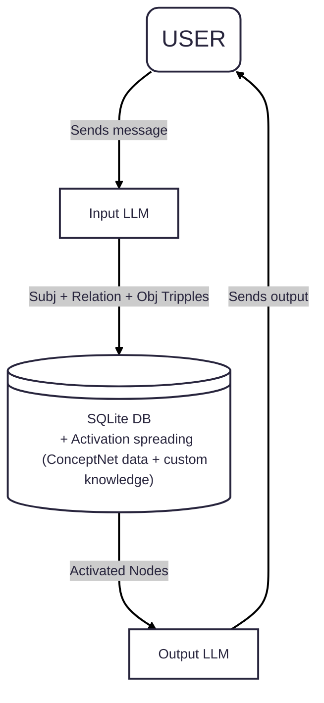

L.O.U.I.S
=========

Lars Original Usefull Intelligent System 

## What is LOUIS
LOUIS is an experiment to create a new memory backend for LLMs and AI agents using **semantic networks** with **spread activation**.
It is inspired by the architecture of the human brain.

Using this project, you hopefully will be able to add a real memory to your AI agent, that works like the human one and does not lose data in the progress like conventional storage methods do.

## How does it work
The following diagram explains the basic working of LOUIS. A detailed explanation follows afterwards.

### Input LLM
LOUIS uses a standard LLM Model to convert natural language input into Subj + Relation + Obj Tripples, that it can understand. This can be virtually any model that runs on your hardware, or even a cloud model if you want.

### Database
The SQLite database acts as the memory of LOUIS. It stores information about different entites and their relationships. I will soon add a graph view, so you can inspect your AIs memory.

When a user input is received, the affected entites are activated, and their connection is strengthend / created. The activation then spreads over a few related nodes when the activation threshold of a node is reached. After each step, a bit of activation decays.

The nodes with the highest activation after a few cycles are outputed and fed into another LLM. The output is also fed back into Obsidian, strengthening the connections of the output nodes and allowing it to learn.

### Output LLM
This can either be an LLM run by LOUIS with a custom system prompt, if you run LOUIS standalone, or it can be your AI agent. It will receive the output that the memory provided.

## How can I use LOUIS?

The base DB of LOUIS will be fed with information from ConceptNet. This will serve as the base knowledge. When you want to use LOUIS for your AI, you can recreate this base db using a provided script and feed / teach it additional information. This can be done by simply talking to it. You can also teach it its identity and name and it will remember it, without needing a heavy system promtp each turn.

Afterwards, your AI should have its own memory and remember what you were talking to it about.

I will try to create a TUI for talking to it, as well as giving it an OpenAI API compatible endpoint, so you can access it using most software designed to interact with LLMs (OpenWebUI for example).
